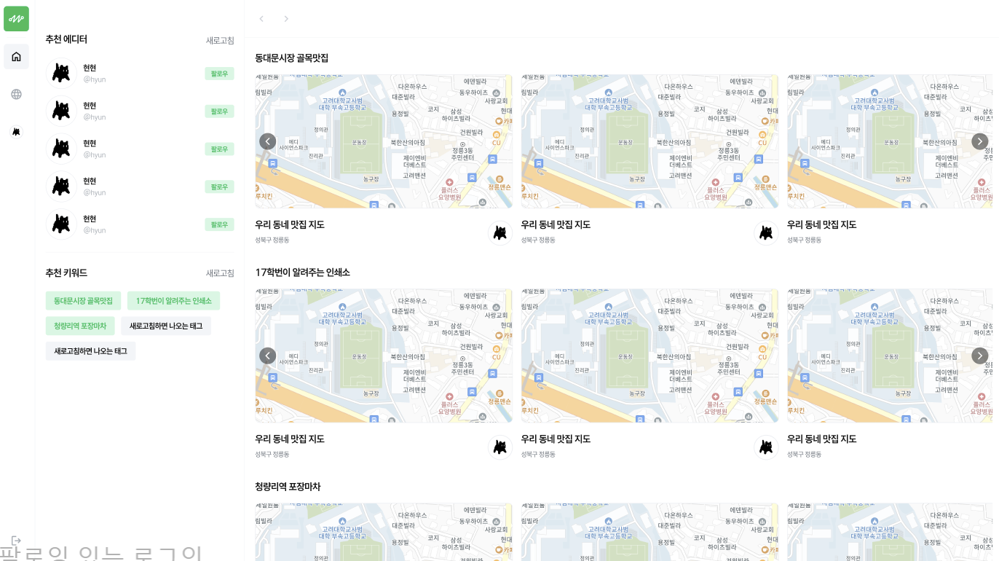
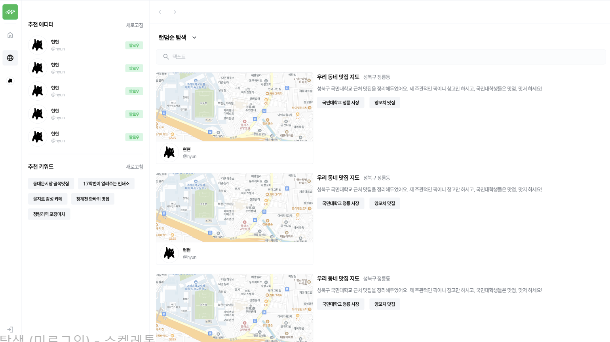
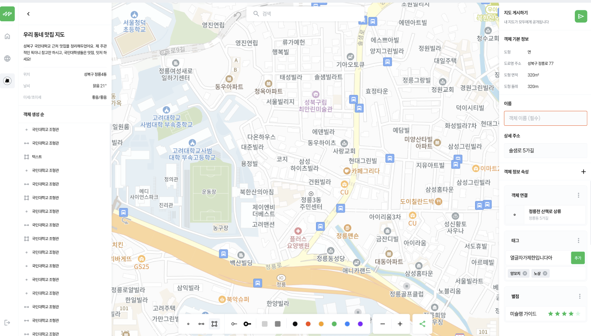

<h2 align="left">
  
  <b>MAPU</b>
</h2>

---
### 1. Project Overview
- 사용자가 지도를 기반으로 다양한 정보를 시각화하고 공유할 수 있는 커뮤니티 플랫폼
- 공유 기능을 통해 친구 또는 팔로워들과 지도를 **함께 편집하거나 뷰어로 접근**할 수 있음
- **약속 잡기 / 맛집 공유 / 테마 지도 만들기** 등 다양한 활용이 가능

### 2. 🎯 주요 특징
- 공개/비공개 지도 생성 및 실시간 편집 기능
- 사용자 간 **팔로우 기능**을 통한 소셜 지도 탐색
- **다른 사용자의 지도에 View 또는 Edit 권한**으로 접근 가능
- 지도에 마커/선/영역을 표시하고, 색상·속성 등을 **직접 커스터마이징**
- **키워드 기반 검색**, 지도 정렬, 추천 에디터/키워드 기능
- 직관적이고 간결한 UI로, 최소 클릭으로 지도 탐색 및 편집 가능

### 3. 🧑‍💻 담당 기능
- **카카오맵 지도 렌더링** 및 초기 로딩 상태 관리
- 지도 상에 **마커(Marker)**, **폴리라인(Polyline)** 등 커스텀 마커 표시 기능 구현
- 사용자가 선택한 색상으로 마커·선의 스타일 동적으로 반영
- `Explore` 페이지, `Timeline` 페이지 구조 이해 
- 키워드 추천 UI와 지도 필터링 기능 연동 테스트 보조

---

> 📷 아래는 실제 동작 및 기능 설계를 설명하는 캡처 화면입니다.

추천 키워드 선택을 통해 지도 탐색 기능 구현

키워드 선택 기반 또는 지도 제목 검색을 통한 지도 탐색 기능 구현

`marker`, `line`, `polygon` 선택 / 선 굵기 선택 / 색 선택으로 사용자 커스첨 지도 편집 기능 구현

